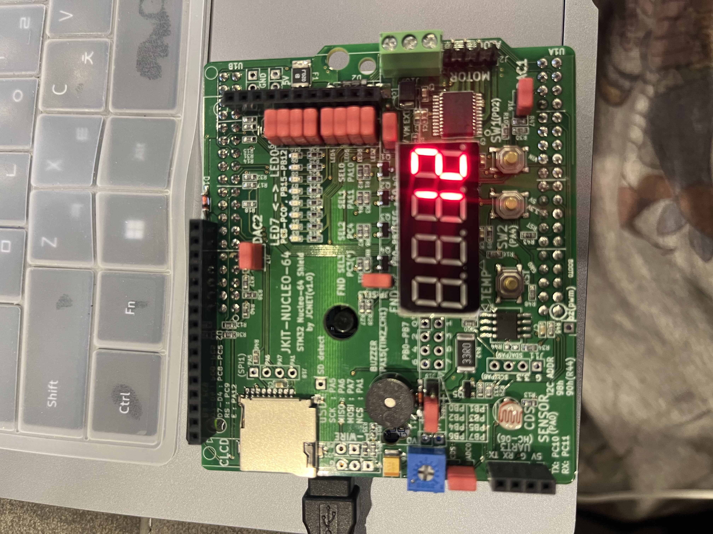
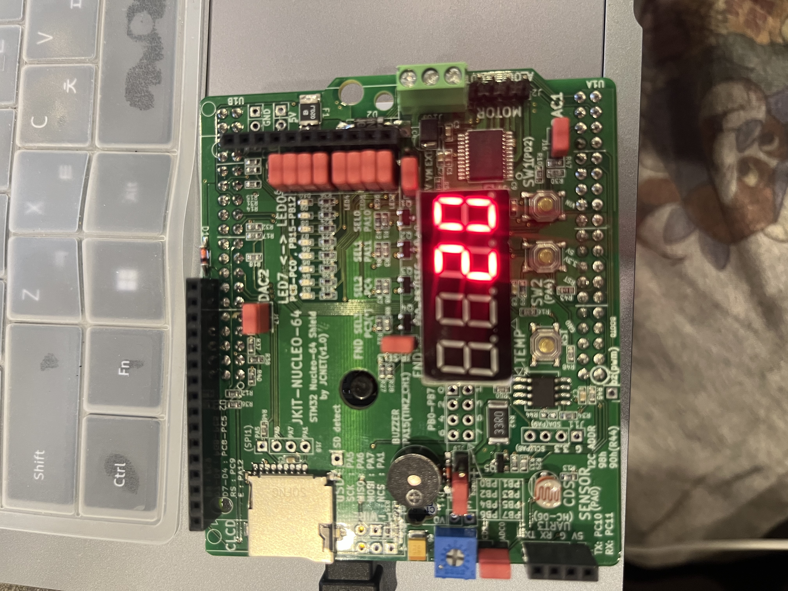
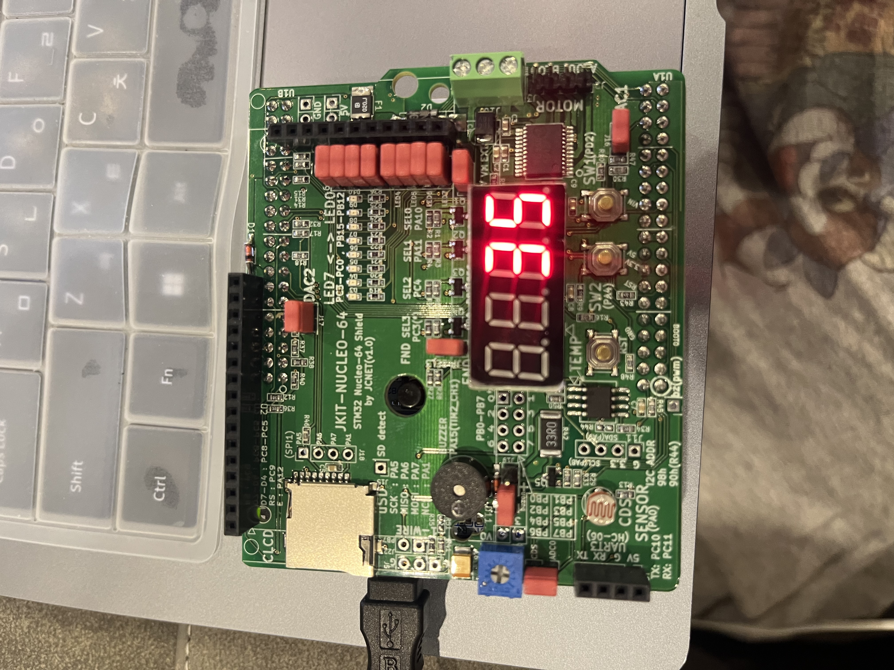
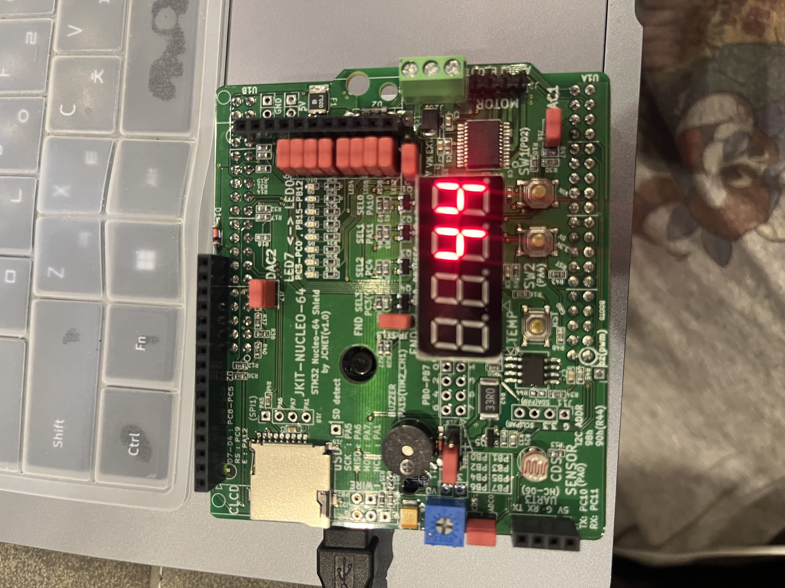
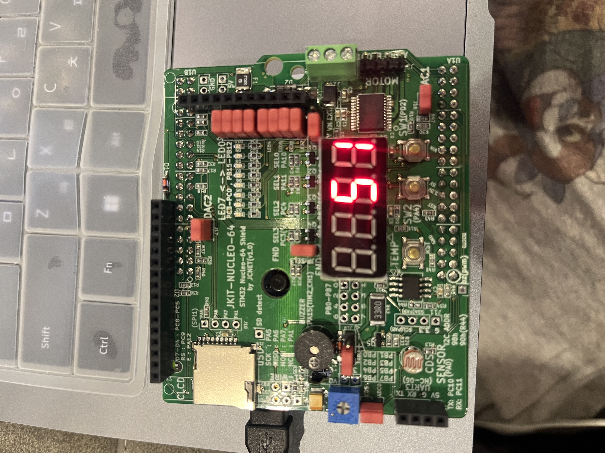
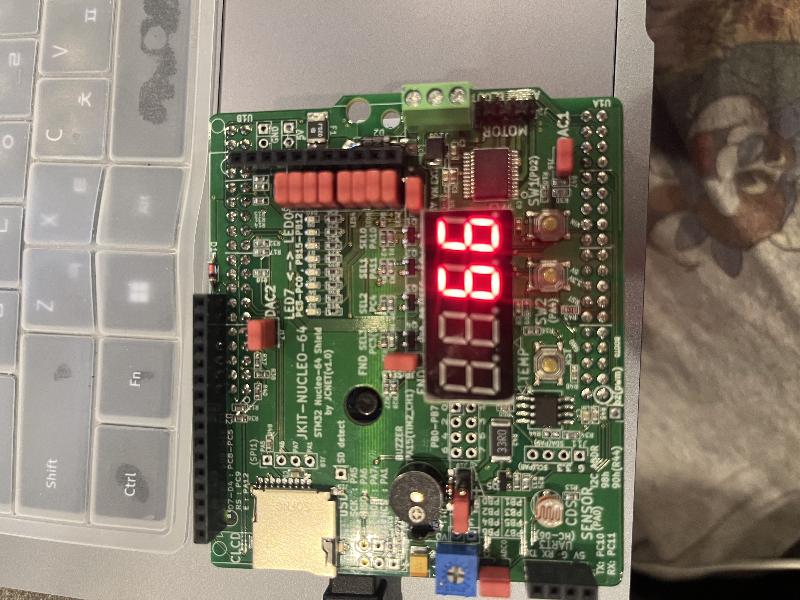
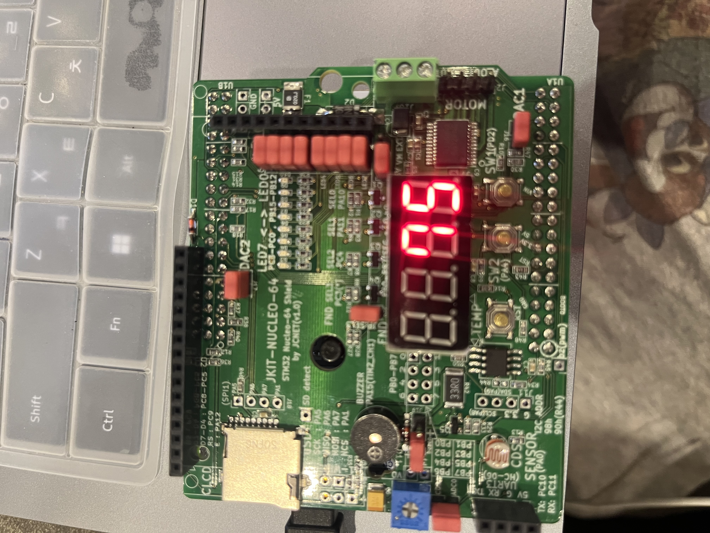
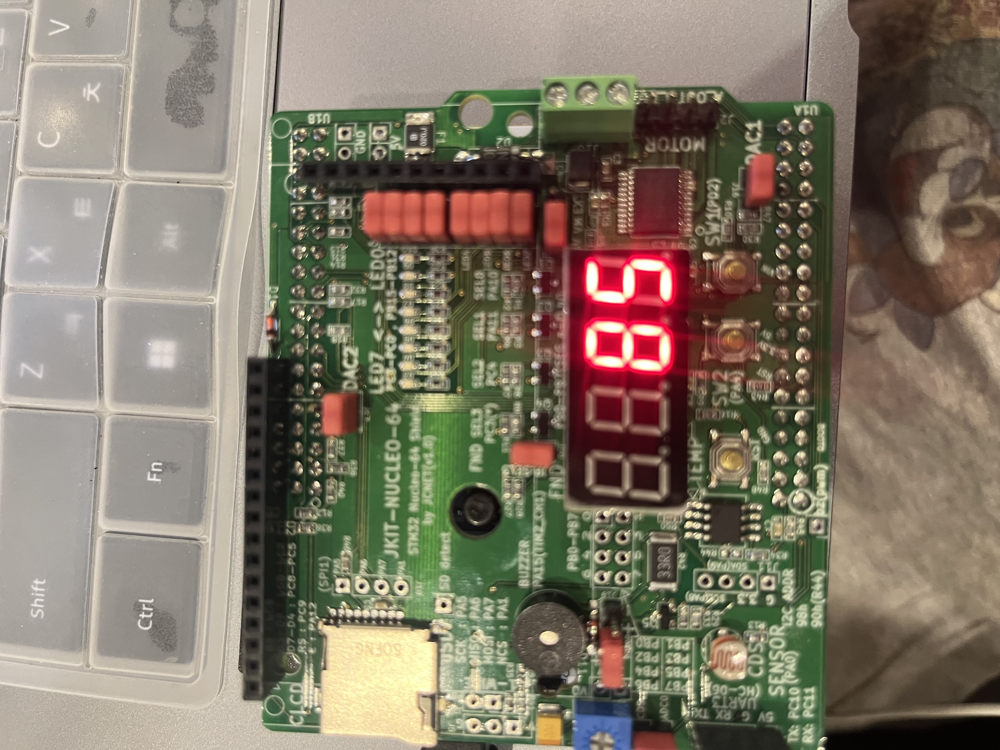
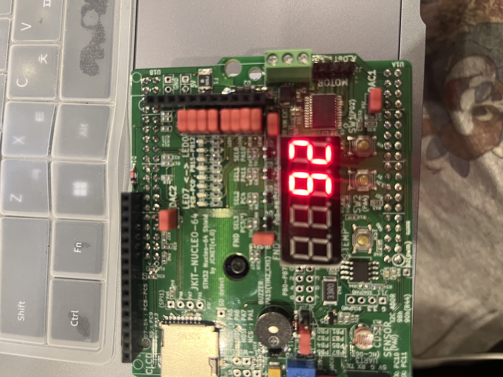

# LAB: EXTI & SysTick(eval board)

**Date:** 2026-10-07

**Author:** Haeun Yang


## Counter on 7-Segment display using EXTI


#### Problem

Create a code to display the counter-up from 0 to 9 and repeating.

- Count up at the rate of 1 sec.
- Pause the counting when SW2 is pressed
- Resets to zero when the push button is pressed: SW1
  - Must use External Interrupts for SW1, SW2


#### Configuration

Configure the MCU GPIO

| Fnction                            | Port-Pin                                                     | Configuration                                 |
| ---------------------------------- | ------------------------------------------------------------ | --------------------------------------------- |
| **Button (SW1) on JKIT**           | PD_2                                                         | DIN, Pull-Up                                  |
| **Button (SW2) on JKIT**           | PA_4                                                         | DIN, Pull-Up                                  |
| **7-Segment DOUT**                 | PB_0, PB_1, PB_2, PB_3, PB_4, PB_5, PB_6, PB_7  ('a'~'g''dot', respectively) | Push-Pull, No Pull-up-Pull-down, Medium Speed |
| **Selection of 7-Segment Display** | PA_10 (FND_0)                                                | DOUT, Push-Pull,                              |


#### Code

```c
/*----------------------------------------------------------------\
@ Embedded Controller by Young-Keun Kim - Handong Global University
Author           : Haeun Yang
Created          : 05-03-2021
Modified         : 10-01-2026
Language/ver     : C++ in VS Code

Description      :Counter on 7-segment display using EXTI
/----------------------------------------------------------------*/

#include "ecSTM32F4v2.h"

#define SW1  PD_2
#define SW2  PA_4
PinName_t _pinFND[8]    = {PB_0, PB_1, PB_2, PB_3, PB_4, PB_5, PB_6, PB_7} ;
PinName_t _selectFND[4] = {PA_10, PA_11, PC_4, PC_3} ;

void pinFNDsetup(PinName_t *pinFND){
    for (int i=0; i<8; i++){
        // GPIO_otype(_pinFND[i], PUSH_PULL) ;  
        GPIO_init(pinFND[i], OUTPUT) ;   
        GPIO_pupd(pinFND[i], NO_PUPD) ;
        GPIO_ospeed(pinFND[i], MEDIUM_SPEED) ;
    }
}

void selectFNDsetup(PinName_t *selectFND){
    for (int i=0; i<4; i++){
        GPIO_init(selectFND[i], OUTPUT) ;  
        GPIO_otype(selectFND[i], PUSH_PULL) ;
    }
}

// Initialize
void setup(void){
    RCC_PLL_init();       // System Clock = 84MHz
    SysTick_init();       // SysTick Timer Initialization
    
    GPIO_init(SW1, INPUT) ;  
    GPIO_pupd(SW1, PU) ;

    GPIO_init(SW2, INPUT) ; 
    GPIO_pupd(SW2, PU) ;

    // Initialize EXTI PA_4
    EXTI_init(SW2, FALL, 10);
    EXTI_init(SW1, FALL, 10);

        
    FND_init(_pinFND) ;          // Intialize FND pins and Others 
    FND_select_init(_selectFND) ; 
    pinFNDsetup(_pinFND) ;
    selectFNDsetup(_selectFND) ;

}

// global  
int count = 0 ;
int secondCount = 0 ;
int pause = 0 ;

// MAIN  ----------------------------------------
int main(void) {
	setup();
    int numDisplay[10]  = {0, 1, 2, 3, 4, 5, 6, 7, 8, 9} ;
    uint8_t selectFND1  = 0 ;
    uint8_t selectFND2  = 1 ;

    int elapsed = 0;

    while (1) {
        FND_select(selectFND1);
        FND_display(_pinFND, numDisplay[count]);
        delay_ms(5);

        FND_select(selectFND2);
        FND_display(_pinFND, numDisplay[secondCount]);
        delay_ms(5);

        elapsed += 10;                  // 이미 걸린 시간
        if (elapsed >= 1000) {          // 100바퀴 = 1초
            elapsed = 0;
            if (pause == 0){
                count++;
                if (count == 10) {
                    count = 0;
                    secondCount++ ;
            }
          }
        }
    }
}

// SW1 is pressed -> resets to zero
void EXTI2_IRQHandler(void) {
	if (is_pending_EXTI(SW1)) {   
		count = 0 ;
        secondCount = 0 ;
		clear_pending_EXTI(SW1);
	}
}
// SW2 is pressed -> pause the counting
void EXTI4_IRQHandler(void) {
    if (is_pending_EXTI(SW2)) {   
        pause = !pause ; 
		clear_pending_EXTI(SW2);
	}
}


```

The functions written in the prelab were reused for this code. To increment the count every second, `delay_ms()` was used; however, it was difficult to implement the counter with this function alone. When FND1 was turned on, followed by FND2, and then `delay_ms(1000)` was called, FND1 was lit only briefly before turning off, so only FND2 appeared to be displayed. To solve this problem, a variable named `elapsed` was introduced. FND1 was turned on followed by `delay_ms(5)`, and then FND2 was turned on followed by another `delay_ms(5)`. Each loop therefore took 10 ms, and this time was accumulated in `elapsed` until it reached 1000 ms, at which point the count was incremented.

In addition, two variables, `count` and `secondCount`, were used. The former stores the ones digit, which increases every second, while the latter stores the tens digit. The code is explained in more detail in the following section.


#### Code Explanation

The GPIO, FND, SysTick and EXTI functions implemented in the [Prelab] EXTI were reused. This section explains the code newly written for this lab.

##### 1. Global Variables

```c
int count       = 0;   // For ones digit
int secondCount = 0;   // For tens digit
int pause       = 0;   // 1: paused, 0: counting
```

`count` stores the ones digit and `secondCount` stores the tens digit. `pause` is a flag that indicates whether counting is paused. These variables are declared as global so that both `main()` and the interrupt handlers can access them. They are also declared as `volatile`, because they are modified inside the interrupt handlers; without `volatile`, the compiler may optimize the code so that `main()` does not read the updated values.


##### 2. `setup()`

```c
void setup(void){
    RCC_PLL_init();       // System Clock = 84MHz
    SysTick_init();       // SysTick Timer Initialization

    GPIO_init(SW1, INPUT);
    GPIO_pupd(SW1, PU);
    GPIO_init(SW2, INPUT);
    GPIO_pupd(SW2, PU);

    EXTI_init(SW2, FALL, 10);
    EXTI_init(SW1, FALL, 10);

    FND_init(_pinFND);
    FND_select_init(_selectFND);
    pinFNDsetup(_pinFND);
    selectFNDsetup(_selectFND);
}
```

- `RCC_PLL_init()` sets the system clock to 84 MHz using the PLL.
- `SysTick_init()` initializes the SysTick timer, which is required by `delay_ms()`.
- SW1 (PD_2) and SW2 (PA_4) are configured as inputs with internal pull-up resistors. Therefore, the pin reads 1 when the switch is released and 0 when it is pressed.
- Since pressing a switch causes a transition from 1 to 0, `EXTI_init()` is called with the falling-edge trigger (`FALL`) and a priority of 10 for both switches.
- Finally, the FND segment pins and digit-select pins are initialized.


##### 3. `pinFNDsetup()` and `selectFNDsetup()`

```c
void pinFNDsetup(PinName_t *pinFND){
    for (int i = 0; i < 8; i++){
        GPIO_init(pinFND[i], OUTPUT);
        GPIO_pupd(pinFND[i], NO_PUPD);
        GPIO_ospeed(pinFND[i], MEDIUM_SPEED);
    }
}

void selectFNDsetup(PinName_t *selectFND){
    for (int i = 0; i < 4; i++){
        GPIO_init(selectFND[i], OUTPUT);
        GPIO_otype(selectFND[i], PUSH_PULL);
    }
}
```

`pinFNDsetup()` configures the eight segment pins (a–g and dp) as outputs with no pull-up/pull-down and medium output speed. `selectFNDsetup()` configures the digit-select pins as push-pull outputs, which choose which FND digit is turned on.


##### 4. Main Loop

```c
int elapsed = 0;

while (1) {
    // Multiplexing: display each digit for 5 ms
    FND_select(selectFND1);
    FND_display(_pinFND, numDisplay[count]);
    delay_ms(5);

    FND_select(selectFND2);
    FND_display(_pinFND, numDisplay[secondCount]);
    delay_ms(5);

    // Timing: increment the count every 1 s
    elapsed += 10;
    if (elapsed >= 1000) {
        elapsed = 0;
        if (pause == 0) {
            count++;
            if (count == 10) {
                count = 0;
                secondCount = (secondCount + 1) % 10;
            }
        }
    }
}
```

**Multiplexing.** The two FNDs share the same segment lines, so only one digit can be lit at a time. The loop turns on FND1 (ones digit) for 5 ms and then FND2 (tens digit) for 5 ms. Since the whole cycle repeats every 10 ms (100 Hz), both digits appear to be lit continuously due to persistence of vision.

**Timing.** Using `delay_ms(1000)` inside the loop would stop the multiplexing for one second, causing one digit to flicker. Instead, the time taken by each loop (10 ms) is accumulated in `elapsed`. When `elapsed` reaches 1000 ms (100 loops), it is reset to 0 and the count is incremented. This allows the display to be refreshed continuously while the count increases every second.

**Pause and carry.** The count is incremented only when `pause` is 0. When `count` reaches 10, it is reset to 0 and `secondCount` is incremented. The modulo operation (`% 10`) makes the counter wrap from 99 back to 00 and prevents `numDisplay` from being accessed out of range.


##### 5. Interrupt Handlers

```c
// SW1 (PD_2) -> reset the count to 00
void EXTI2_IRQHandler(void) {
    if (is_pending_EXTI(SW1)) {
        count = 0;
        secondCount = 0;
        clear_pending_EXTI(SW1);
    }
}

// SW2 (PA_4) -> pause / resume the count
void EXTI4_IRQHandler(void) {
    if (is_pending_EXTI(SW2)) {
        pause = !pause;
        clear_pending_EXTI(SW2);
    }
}
```

The name of an EXTI handler is determined by the pin number, not the port. SW1 is connected to PD_2, so it is handled by `EXTI2_IRQHandler()`, and SW2 is connected to PA_4, so it is handled by `EXTI4_IRQHandler()`. (Pins 5–9 and 10–15 share `EXTI9_5_IRQHandler()` and `EXTI15_10_IRQHandler()`, respectively.)

Each handler first checks the pending bit with `is_pending_EXTI()`, performs its task, and then clears the pending bit with `clear_pending_EXTI()`. If the pending bit is not cleared, the handler is executed repeatedly and the program cannot return to `main()`.

- `EXTI2_IRQHandler()` resets both `count` and `secondCount` to 0.
- `EXTI4_IRQHandler()` toggles the `pause` flag, so each press of SW2 alternates between pausing and resuming.

The handlers only change variables and return immediately. The actual counting and display are performed in `main()`. Keeping the handlers short prevents them from blocking the FND multiplexing in the main loop.


#### Results

<p align="center">
  
  <br>
  
  <br>
  
</p>


The 0–99 up-counter was successfully implemented, as shown in the figure above.

Demonstration videos of the counting and the SW1/SW2 button operations are available at the following links.

[demo video link](https://youtube.com/shorts/ImWWvPx8iEM)


#### Discussion

1. Analyze the result and explain any other necessary discussion.

> The two-digit counter operated as intended. The count increased by one every second from 00 to 99 and then wrapped back to 00, with the tens digit incrementing each time the ones digit rolled over from 9 to 0. SW1 reset the count to 00 and SW2 paused and resumed the count, both handled by external interrupts.
>
> Since both FNDs share the same segment lines, only one digit can be lit at a time. In the first attempt, `delay_ms(1000)` was placed inside the main loop, so one digit was lit for only 1 ms per second and appeared to flicker. By alternating the two digits every 5 ms (a 100 Hz refresh rate), persistence of vision made both digits appear to be lit continuously.
>
> To keep refreshing the display while counting, the loop time (10 ms) was accumulated in a variable, and the count was incremented once every 1000 ms instead of blocking with a long delay. However, because the execution time of the display functions is not included, the actual period is slightly longer than one second. A SysTick or timer interrupt would be needed for more accurate timing.
>
> When the switches were first implemented by polling, presses made during `delay_ms(1000)` were missed. Using EXTI, the switches responded immediately even during the delay. Waiting for the button inside the interrupt handler stopped the main loop and broke the display, so the handler was designed only to change a flag, and the actual processing was done in the main loop. In addition, switch bouncing can generate several interrupts from a single press, so debouncing is required for reliable operation.


2. We can use two different methods to detect an external signal: polling and interrupt. What are the advantages and disadvantages of each approach?

> **Polling** is a method in which the CPU repeatedly reads the state of the input pin. Its advantages are that it is simple to implement, its program flow is predictable, and it is easy to debug. However, any signal that occurs while the CPU is not checking the pin, such as during a delay, can be missed. The response time depends on the loop period, and CPU time is wasted on constantly checking the input.
>
> **Interrupt** is a method in which the hardware detects the signal and calls the interrupt handler automatically. Its advantages are a fast response, no missed short signals, and the ability of the CPU to perform other tasks or enter low-power modes while waiting. However, it requires more complex configuration (EXTI, NVIC, pending flags), variables shared with the main routine must be declared global, and switch bouncing can trigger the handler several times. It is also harder to debug, and a long handler can delay the rest of the system.
>
> In this experiment, polling missed button presses during the one-second delay, whereas the interrupt method responded immediately, which shows why interrupts are more suitable for detecting asynchronous external events.


3. What would happen if the EXTI interrupt handler does not clear the interrupt pending flag? Check with your code

> If the pending flag is not cleared, the pending bit remains set after the handler returns. The NVIC therefore treats the interrupt as still unserviced and immediately executes the handler again. This repeats indefinitely, so the program becomes stuck in the interrupt handler.
>
> To verify this, the line `clear_pending_EXTI(SW2);` was commented out and SW2 was pressed. As a result, the main loop no longer executed: the FND multiplexing stopped, leaving only one digit lit, and the count stopped increasing. In addition, `pause` was toggled continuously, so the pause function no longer worked correctly, and other interrupts with equal or lower priority, such as the SW1 reset, could not be serviced. This shows that the pending flag must always be cleared at the end of the interrupt handler.


### Reference

[1] STMicroelectronics, "RM0383 Reference manual: STM32F411xC/E advanced Arm-based 32-bit MCUs," Rev. 3.
[2] Arm Ltd., "Cortex-M4 Devices Generic User Guide," DUI0553.
[3] Digilent Inc., "PmodSSD Reference Manual," Rev. A, May 2016.
[4] STMicroelectronics, "AN1781: STR71x GPIO driving four 7-segment display," Application note.
[5] J. G. Ganssle, "A Guide to Debouncing," The Ganssle Group, Rev. 3, Jun. 2008. [Online]. Available: https://www.ganssle.com/debouncing.htm
[6] Texas Instruments, "MSP432E4 SimpleLink Microcontrollers Technical Reference Manual," SLAU723A, Oct. 2018.
[7] INFLIBNET Centre, "Interrupt Handling," e-PG Pathshala. [Online]. Available: https://ebooks.inflibnet.ac.in/csp13/chapter/interrupt-handling

