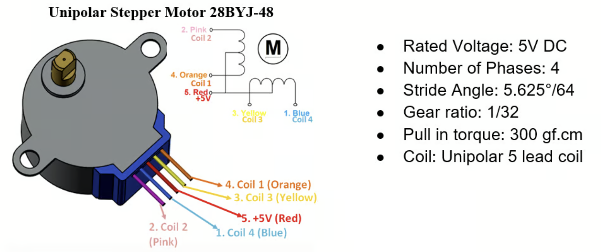
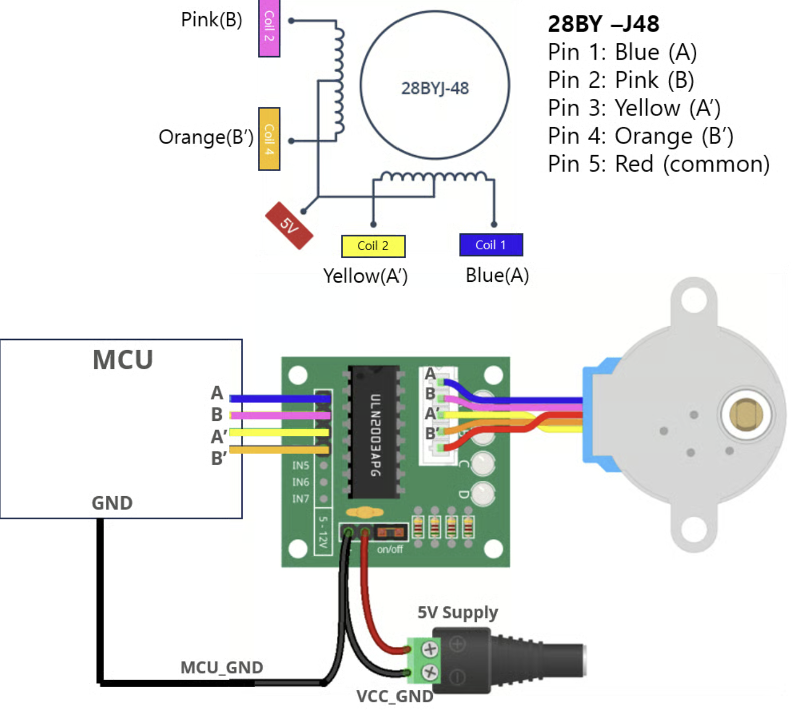
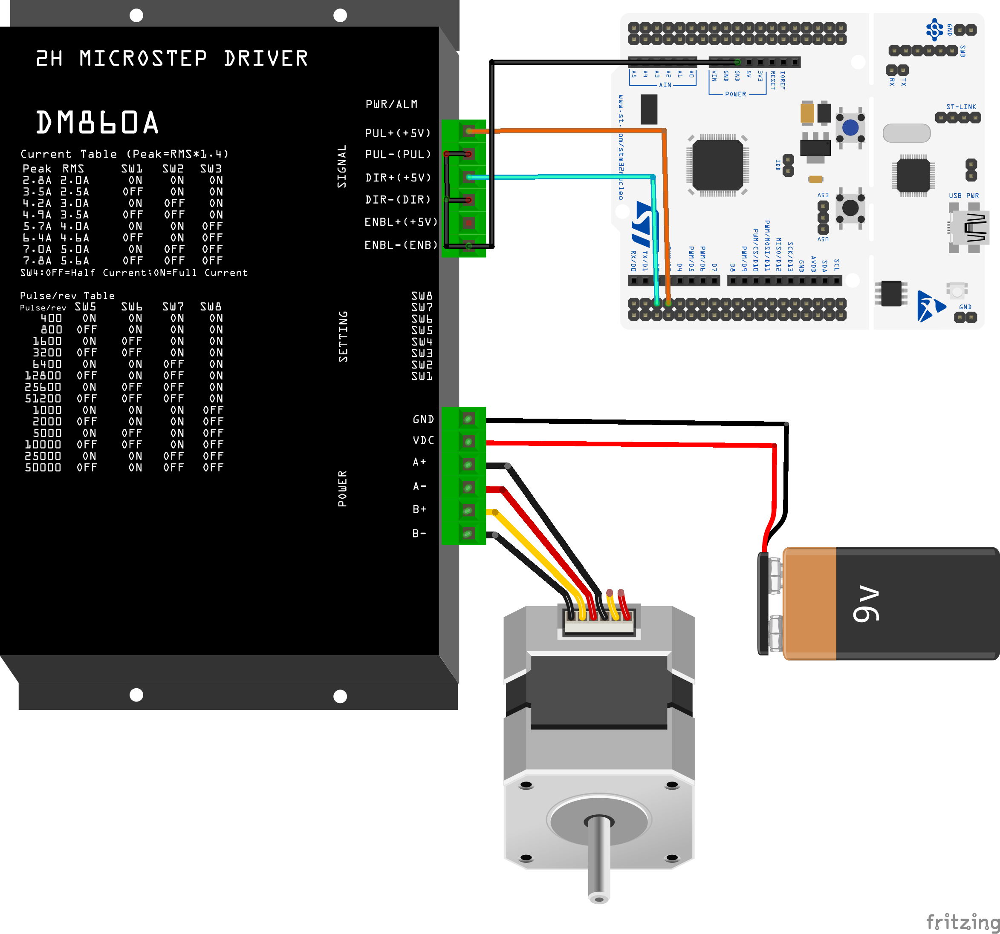
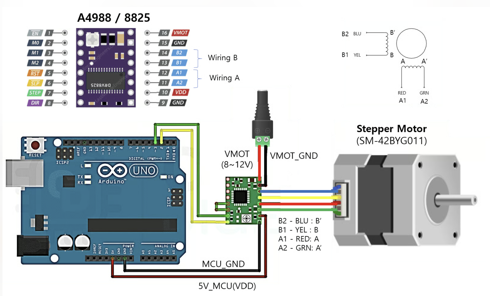

# LAB: Stepper Motor

**Date:** 2026-10-14

**Author/Partner:** YOUR NAME GOES HERE

**Demo Video:** [demo video link](youtube.com/watch?v=DcJxc1tsqTo&feature=youtu.be)


## Introduction

#### Requirement

**Hardware**

- MCU
  - NUCLEO-F411RE
- Actuator/Sensor/Others:
  - **Tutorial:**
    - Stepper Motor SM-42BYG011 (12V)
    - Motor Driver A4988
  - **Lab:**
    - Stepper Motor 28BYJ-48 (5V)
    - Motor Driver ULN2003
  - breadboard

**Software**

- Keil uVision, CMSIS, EC_HAL library


## spec

- **Driver:** **ULN2003 motor driver.**[ULN2003 spec sheet](https://www.electronicoscaldas.com/datasheet/ULN2003A-PCB.pdf)
- **Motor:** 28BYJ-48





## FSM design for Stepper Motor Sequence

### **State Table for Full-Stepping**

- **Full-stepping sequence**


- **State Table**: Moore FSM


### **State Table for Half-Stepping**

- **Half-stepping sequence**


- **State Table**: Moore FSM


## Code

#### **Function Definitions (ecStepper.h)**

```c
#include "stm32f411xe.h"
#include "ecPinNames.h"
#include "ecRCC2.h"
#include "ecGPIO2.h"
#include "ecSysTick2.h"
			
#ifndef __EC_STEPPER2_H
#define __EC_STEPPER2_H

#ifdef __cplusplus
 extern "C" {
#endif /* __cplusplus */

// Stepper Mode
#define HALF 0
#define FULL 1	 
#define DIR_CW 0
#define DIR_CCW 1	  


//State number 
typedef enum {
	S0, S1, S2, S3, S4, S5, S6, S7
} StateNum;

// FULL stepping sequence  - FSM
typedef struct {	
  uint32_t next[2];
  uint8_t out[4];
} StateStepper_t;

// Initialization of Stepper Motor
void stepper_init(uint32_t mode, PinName_t *pinStepper);

// Return step per revolution, always return 1 rpm
uint32_t stepper_stepPerRev(void) ;

// Converts Motor [rpm] to step delay in [msec]
void stepper_speed (uint32_t speedRPM);

// Run Stepper Motor for given steps and direction
void stepper_step(uint32_t steps, uint32_t direction) ;

// Stepper Motor Output for given state
void stepper_out(uint32_t state);

// Stop Stepper Motor
void stepper_stop(void);


#ifdef __cplusplus
}
#endif /* __cplusplus */

#endif // __EC_STEPPER2_H

```


### **Function Explanation (ecStepper.c)**

```c
#include "stm32f4xx.h"
#include "ecStepper.h"


// Stepper Motor variable
// Stepper Motor Spec
// 28BYJ-48 : 64 steps/rev x 1/32 gear = 2048 
static uint32_t STEP_PER_REV ;
static PinName_t stepperPins[4] ;
static volatile uint32_t _steps ;
static volatile uint32_t _step_delay = 100 ; 		
static const StateStepper_t *fsm ;		// points at fsm_full or fsm_half (chosen in stepper_init)
static volatile uint32_t state = 0 ;	// current FSM state


// Output: A B A' B'
static const StateStepper_t fsm_Full[4] = {	
	{{S1,S3},{HIGH,HIGH,LOW,LOW}},	
 	{{S2,S0},{LOW,HIGH,HIGH,LOW}},	
 	{{S3,S1},{LOW,LOW,HIGH,HIGH}},	
 	{{S0,S2},{HIGH,LOW,LOW,HIGH}}
};


static const StateStepper_t fsm_Half[8] = {  
	{{S1,S7},{1,0,0,0}},
	{{S2,S0},{1,1,0,0}},
	{{S3,S1},{0,1,0,0}},
	{{S4,S2},{0,1,1,0}},
	{{S5,S3},{0,0,1,0}},
	{{S6,S4},{0,0,1,1}},
	{{S7,S5},{0,0,0,1}},
	{{S0,S6},{1,0,0,1}}
};


// Initialization of Stepper Motor
void stepper_init(uint32_t mode, PinName_t *pinStepper){
	if (mode == HALF) {
		fsm = fsm_Half;
		STEP_PER_REV = 4096 ; // instead of #define, for always making 1 rpm 
	}
	else{
		fsm = fsm_Full;
		STEP_PER_REV = 2048 ;
	}
	//  GPIO Digital Out Initiation
	// For A, B, AN, BN

	for (int i=0; i<4; i++){
		stepperPins[i] = pinStepper[i];
		GPIO_init(stepperPins[i], OUTPUT) ;
		GPIO_ospeed(stepperPins[i], FAST_SPEED) ;
	} 
}

uint32_t stepper_stepPerRev(void) {    // for main.c
	return STEP_PER_REV ;
}

// Converts Motor [rpm] to step delay in [msec]
void stepper_speed (uint32_t speedRPM){      // rpm
		_step_delay = 60*1000/(STEP_PER_REV*speedRPM) ; // in [msec]	
		// [usec] can be used for a higher accuracy
		// But needs delay_us() 

}


// Run Stepper Motor for given steps and direction
void stepper_step(uint32_t steps, uint32_t direction){
	// Exit if stepper_init() not called 
	if (fsm == 0) return ;
	_steps = steps ;

	// run for step size: 
	for (uint32_t i = 0; i < _steps; i++){
		// Update Present State
		if (direction == DIR_CCW) state = fsm[state].next[1] ; 
		else state = fsm[state].next[0] ; // CW

		// Output of Present State
		stepper_out(state) ;
	
		// Delay for steppermotor speed
		delay_ms(_step_delay) ;
	}
}

// Stepper Motor Output for given state
void stepper_out(uint32_t state){
	
	// stepperPins[0]=A, stepperPins[1]=B, ...
	//out[0]=A, out[1]=B, ...

	for (int i = 0; i < 4; i++) {
		GPIO_write(stepperPins[i], fsm[state].out[i]);
	}
	
}

// Stop Stepper Motor
void stepper_stop(void) {
    _steps = 0;    
    
	for (int i=0; i<4; i++) GPIO_write(stepperPins[i],  0) ;
}

```


### **stepper_init()**

Selects the FSM table and the number of steps per revolution according to the drive mode (Full/Half), and initializes the four output pins (A, B, A', B') as GPIO outputs.

```c
void stepper_init(uint32_t mode, PinName_t *pinStepper)
```

#### Parameters

- `mode`: Drive mode. `FULL` or `HALF`
- `pinStepper`: Array of pins connected in the order A, B, A', B'

```c
void stepper_init(uint32_t mode, PinName_t *pinStepper){
	if (mode == HALF) {
		fsm = fsm_Half;
		STEP_PER_REV = 4096 ;
	}
	else{
		fsm = fsm_Full;
		STEP_PER_REV = 2048 ;
	}

	for (int i=0; i<4; i++){
		stepperPins[i] = pinStepper[i];
		GPIO_init(stepperPins[i], OUTPUT) ;
		GPIO_ospeed(stepperPins[i], FAST_SPEED) ;
	} 
}
```

#### Example code

```c
PinName_t pinStepper[4] = {PB_10, PB_4, PB_5, PB_3};   // A, B, A', B'
stepper_init(FULL, pinStepper);
```

---


### **stepper_stepPerRev()**

Returns the number of steps required for one revolution of the output shaft in the current mode. (Full: 2048, Half: 4096)

```c
uint32_t stepper_stepPerRev(void)
```

#### Parameters

- None

```c
uint32_t stepper_stepPerRev(void) {
	return STEP_PER_REV ;
}
```

#### Example code

```c
uint32_t rev   = 1;
uint32_t steps = stepper_stepPerRev() * rev;
```

---


### **stepper_speed()**

Converts the motor speed [rpm] into the delay time per step [ms] and sets it.

```c
void stepper_speed(uint32_t speedRPM)
```

#### Parameters

- `speedRPM`: Target rotation speed [rpm]

```c
void stepper_speed (uint32_t speedRPM){
	_step_delay = 60*1000/(STEP_PER_REV*speedRPM) ;   // [msec]
}
```

#### Example code

```c
stepper_speed(2);   // 2 rpm
```

---


### **stepper_step()**

Rotates the motor by the given number of steps in the given direction. At each step, the next state is determined from the present state and the direction, the output of that state is applied, and then the function waits for `_step_delay`.

```c
void stepper_step(uint32_t steps, uint32_t direction)
```

#### Parameters

- `steps`: Number of steps to rotate
- `direction`: Rotation direction. `DIR_CW` (clockwise) or `DIR_CCW` (counterclockwise)

```c
void stepper_step(uint32_t steps, uint32_t direction){
	if (fsm == 0) return ;
	_steps = steps ;

	for (uint32_t i = 0; i < _steps; i++){
		if (direction == DIR_CCW) state = fsm[state].next[1] ; 
		else state = fsm[state].next[0] ;

		stepper_out(state) ;
		delay_ms(_step_delay) ;
	}
}
```

#### Example code

```c
stepper_step(stepper_stepPerRev(), DIR_CW);   // one revolution, clockwise
```

---


### **stepper_out()**

Reads the output values of the given state from the FSM table and writes them to the A, B, A', B' pins.

```c
void stepper_out(uint32_t state)
```

#### Parameters

- `state`: FSM state number to output (Full: S0–S3, Half: S0–S7)

```c
void stepper_out(uint32_t state){
	for (int i = 0; i < 4; i++) {
		GPIO_write(stepperPins[i], fsm[state].out[i]);
	}
}
```

#### Example code

```c
stepper_out(S0);   // Full: A=1, B=1, A'=0, B'=0
```

---


### **stepper_stop()**

Sets the remaining step count to 0 so that the rotation loop in `stepper_step()` ends, and sets all coil outputs to LOW to stop the motor.

```c
void stepper_stop(void)
```

#### Parameters

- None

```c
void stepper_stop(void) {
    _steps = 0;    
	for (int i=0; i<4; i++) GPIO_write(stepperPins[i], 0) ;
}
```

#### Example code

```c
void EXTI15_10_IRQHandler(void) {  
	if (is_pending_EXTI(BUTTON_PIN)) {
		stepper_stop();
		clear_pending_EXTI(BUTTON_PIN);
	}
}
```


### **Main**

```c
#include "stm32f411xe.h"
#include "ecGPIO2.h"
#include "ecRCC2.h"
#include "ecEXTI2.h"
#include "ecSysTick2.h"
#include "ecStepper.h"

// ( A, B,  AN,  BN)
PinName_t pinStepper[4]    = {PB_10,PB_4,PB_5,PB_3};
#define BUTTON_PIN PC_13 

// Initialiization 
void setup(void){	
	RCC_PLL_init();                                 // System Clock = 84MHz
	SysTick_init();                                 // Systick init
	
	GPIO_init(BUTTON_PIN, INPUT);           		// GPIOC pin13 initialization
    EXTI_init(BUTTON_PIN, FALL, 0);           		// External Interrupt Setting

	stepper_init(FULL, pinStepper); 				// Stepper GPIO pin initialization
	stepper_speed(14);                          		//  set stepper motor speed
}


int main(void) { 
	// Initialiization --------------------------------------------------------
	setup();
	uint32_t rev=1;
	uint32_t steps=stepper_stepPerRev()*rev;
	
	// Inifinite Loop ----------------------------------------------------------
	// while(1){
		stepper_step(steps, DIR_CW);  // (Step : 2048, Direction : 0 or 1, Mode : FULL or HALF)
		delay_ms(2000);
		// stepper_step(steps, DIR_CCW);  // (Step : 2048, Direction : 0 or 1, Mode : FULL or HALF)
		// delay_ms(2000);
	// }
}


void EXTI15_10_IRQHandler(void) {  
	if (is_pending_EXTI(BUTTON_PIN)) {
		stepper_stop();
		clear_pending_EXTI(BUTTON_PIN); // cleared by writing '1'
	}
}
```


## Configuration

| Function     | Pins                | Configuration |
| ------------ | ------------------- | ------------- |
| A, B, A', B' | PB10, PB4, PB5, PB3 | DOUT, FAST    |


## Connection Diagram




## Discussion

**1. Find out the trapezoid-shape velocity profile for a stepper motor. When is this profile necessary?**

A trapezoidal velocity profile consists of three phases: constant acceleration, constant speed, and constant deceleration (Atmel Corporation, 2006). Instead of starting at the target speed immediately, the step delay is gradually decreased during acceleration and increased during deceleration.

This profile is necessary because the torque of a stepper motor decreases as speed increases. The speed at which the motor can start directly from rest (pull-in) is lower than the speed it can maintain once running (pull-out) (Condit & Jones, 2004). Therefore, when the target speed is high or the load inertia is large, an abrupt start causes missed steps or stalling, and an abrupt stop causes overshoot. In this experiment, the motor did not start when the step delay was reduced from 2 ms to 1 ms, which an acceleration ramp could overcome.


**2. How would you change the code more efficiently for micro-stepping control? You don’t have to code this but need to explain your strategy.**

Micro-stepping drives the two coils with sine and cosine currents instead of on/off signals, so the rotor can stop between full steps (Chang & Tran, 2025). The strategy is as follows:

- **Output table:** Replace the 0/1 output table with a sine lookup table of PWM duty cycles. Only a quarter of the sine wave needs to be stored because of its symmetry.
- **Next state:** Calculate the next state as `index = (index ± 1) % N` instead of storing a `next[]` table, since the number of states becomes large.
- **Output method:** Drive the coils with timer PWM outputs instead of `GPIO_write()`. All four pins used (PB10, PB4, PB5, PB3) support timer PWM (STMicroelectronics, 2024).
- **Timing:** Replace `delay_ms()` with a timer interrupt, because micro-steps require step periods shorter than 1 ms.


**3. There are other types of Stepper Motor Drivers that are simple to use, such as you only give one pulse signal and direction, instead of giving 4 pulse signals. Such examples are A4988, DRV 8834, and TB6600 drivers. Compare these motor drivers with ULN2003 in terms of operating method.**

The ULN2003 is only a Darlington transistor array without any sequencing logic (Texas Instruments, 2025). The microcontroller must generate the phase sequence and control four pins at every step, as done by the FSM in this experiment.

In contrast, the A4988, DRV8834, and TB6600 have a built-in translator. The microcontroller only sends one pulse to the STEP pin to move one step and sets the direction with the DIR pin (Allegro MicroSystems, 2022; Texas Instruments, 2015; Toshiba Corporation, 2014). These drivers also regulate the coil current and support micro-stepping in hardware, which reduces the CPU load.d

| Item            | ULN2003            | A4988 / DRV8834 / TB6600       |
| --------------- | ------------------ | ------------------------------ |
| Control signals | 4 phase signals    | STEP + DIR                     |
| Step sequence   | MCU software (FSM) | Built-in translator            |
| Current control | None               | PWM current regulation         |
| Micro-stepping  | Not supported      | Supported (up to 1/16 or 1/32) |
| MCU load        | High               | Low                            |


## Results

[demo video link](youtube.com/watch?v=DcJxc1tsqTo&feature=youtu.be)


## Reference

Allegro MicroSystems. (2022). *A4988: DMOS microstepping driver with translator and overcurrent protection* (Datasheet 4988-DS, Rev. 8). https://www.allegromicro.com/-/media/files/datasheets/a4988-datasheet.pdf

Atmel Corporation. (2006). *AVR446: Linear speed control of stepper motor* (Application Note 8017A–AVR–06/06). https://www.microchip.com/en-us/application-notes/an8017

Austin, D. (2004, December 30). Generate stepper-motor speed profiles in real time. *Embedded.com*. https://www.embedded.com/?p=4006438

Chang, C., & Tran, T. (2025). Mastering precision: Understanding microstepping in motion control. *Analog Dialogue, 59*(2). https://www.analog.com/en/resources/analog-dialogue/articles/mastering-precision-understanding-microstepping.html

Condit, R., & Jones, D. W. (2004). *Stepping motors fundamentals* (Application Note AN907, DS00907A). Microchip Technology Inc. https://www.microchip.com/en-us/application-notes/an907

STMicroelectronics. (2024). *STM32F411xC STM32F411xE: Arm Cortex-M4 32-bit MCU+FPU* (Datasheet DS10314, Rev. 8). https://www.st.com/resource/en/datasheet/stm32f411re.pdf

Texas Instruments. (2015). *DRV8834 dual-bridge stepper or DC motor driver* (Datasheet SLVSB19D). https://www.ti.com/lit/ds/symlink/drv8834.pdf

Texas Instruments. (2025). *ULN200x, ULQ200x high-voltage, high-current Darlington transistor arrays* (Datasheet SLRS027T). https://www.ti.com/lit/ds/symlink/uln2003a.pdf

Toshiba Corporation. (2014). *TB6600HG: PWM chopper-type bipolar stepping motor driver IC* [Datasheet]. https://www.makerguides.com/wp-content/uploads/2019/10/TB6600HG-Datasheet.pdf


## Trouble shooting

When the motor was driven at 1 rpm, one revolution was expected to take 60 s, but the measured time was 58 s. Two sources of timing error were identified.

First, the step delay is calculated in milliseconds using integer division, so the fractional part is truncated:

$$
\text{delay} = \frac{60 \times 1000}{2048 \times 1} = 29.30\ \text{ms} \;\rightarrow\; 29\ \text{ms}
$$

This alone shortens one revolution to 
$$
2048 \times 29\ \text{ms} \approx 59.4\ \text{s}
$$
Second, `delay_ms()` counts 1 ms SysTick ticks. Because the function is called at an arbitrary point within a tick, the first tick arrives earlier than 1 ms, and the actual delay lies between (n-1) and n ms, which is about 0.5 ms shorter on average. Since this error accumulates over 2048 steps, one revolution becomes approximately 
$$
2048 \times 28.5\ \text{ms} \approx 58.4\ \text{s}
$$
, which agrees well with the measured value.

Both errors can be reduced by calculating the step delay in microseconds and generating it with a microsecond-resolution timer, such as `delay_us()` or a hardware timer interrupt.


## Tutorial: Stepper Motor Driver (A4988)








### **Tutorial code**

```c
#include "stm32f411xe.h"
#include "ecRCC2.h"
#include "ecGPIO2.h"
#include "ecSysTick2.h"  

#define MOTOR_DIR PB_3  
#define MOTOR_PULSE PA_10

void setup(void)
{
	RCC_PLL_init();                
    SysTick_init(); 
    GPIO_init(MOTOR_DIR, OUTPUT);      
    GPIO_init(MOTOR_PULSE, OUTPUT);      
}


int main(void) {	    
	setup();
    // Set Dir high (CW)
    GPIO_write(MOTOR_DIR, HIGH);     
	while(1){
          for(x = 0; x < 1000; x++) 
		  {
            GPIO_write(MOTOR_PULSE, HIGH);        
        	delay_ms(10);
	        GPIO_write(MOTOR_PULSE, LOW);        
	        delay_ms(10);
          }
        delay_ms(1000);
	}
}

```

