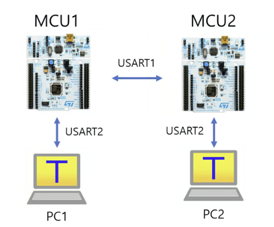
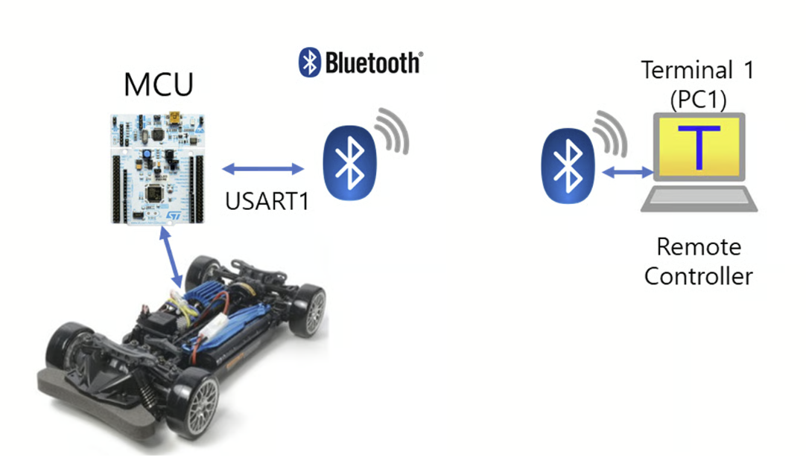

# LAB: USART

**Date:** 2026-10-28

**Author/Partner:** Haeun Yang / Junghyeon choi

**Github:** https://github.com/haeunyang5/EC-STM32F4-22300442

**Demo Video:** 

[LAB_USART_P1](https://youtu.be/SAkkrmDjDRw)

[LAB_USART_P2](https://youtu.be/yE6jbFSpVLo)

**PDF version:** LAB_USART_22300442_HaeunYang.pdf


## Introduction

#### Requirement

#### Hardware

- MCU
  - NUCLEO-F411RE 
- Actuator/Sensor/Others:
  - Bluetooth Module (HC-06)
  - Stepper Motor 28BYJ-48 (5V), Motor Driver ULN2003
  - jumper wires, breadboard

**Software**

- VS Code (PlatformIO), CMSIS, EC_HAL library, Tera Term


## Problem 0: USART Library

### Function Definitions (ecUART2.h)

```c
#define POL 0
#define INT 1

#define BAUD_9600	9600
#define BAUD_19200	19200
#define BAUD_38400  38400
#define BAUD_57600	57600
#define BAUD_115200 115200
#define BAUD_921600 921600

/*================ General Configuration ================*/
void USART_init(USART_TypeDef* USARTx, PinName_t pin_GPIO_TX, PinName_t pin_GPIO_RX, uint32_t baud);
void USART_baud(USART_TypeDef* USARTx, uint32_t baud);
void USART_pins(USART_TypeDef* USARTx, PinName_t pin_GPIO_TX, PinName_t pin_GPIO_RX);
void USART1_baud(uint32_t baud);
void USART2_baud(uint32_t baud);

/*================ Configuration for each USART (provided) ================*/
void USART1_init(void);
void USART2_init(void);
void USART1_write(uint8_t* buffer, uint32_t nBytes);
void USART2_write(uint8_t* buffer, uint32_t nBytes);
uint8_t USART1_read(void);										
uint8_t USART2_read(void);	
uint32_t is_USART1_RXNE(void);
uint32_t is_USART2_RXNE(void);
```

### Function Explanation (ecUART2.c)

#### USART_init()

Initializes the selected USART: configures the TX/RX pins, enables the USART clock, sets the frame format (no parity, 8-bit data, 1 stop bit, oversampling ×16) and the baud rate, and enables the RXNE interrupt of that USART.

```c
void USART_init(USART_TypeDef* USARTx, PinName_t pin_GPIO_TX, PinName_t pin_GPIO_RX, uint32_t baud)
```

**Parameters**

- `USARTx` : USART peripheral (`USART1`, `USART2`, `USART6`)
- `pin_GPIO_TX` : TX pin (e.g., `PA_9`)
- `pin_GPIO_RX` : RX pin (e.g., `PA_10`)
- `baud` : Baud rate (e.g., `9600`)

```c
void USART_init(USART_TypeDef* USARTx, PinName_t pin_GPIO_TX, PinName_t pin_GPIO_RX, uint32_t baud){
	// 1. GPIO pins for TX and RX
	USART_pins(USARTx, pin_GPIO_TX, pin_GPIO_RX);

	// 2. USARTx configuration
	USART_clock_enable(USARTx);
	USARTx->CR1 &= ~USART_CR1_UE;       // USART disable while configuring

	// No parity / 8-bit word length / oversampling x16 / 1 stop bit
	USARTx->CR1 &= ~USART_CR1_PCE;    
	USARTx->CR1 &= ~USART_CR1_M;      
	USARTx->CR1 &= ~USART_CR1_OVER8;   
	USARTx->CR2 &= ~USART_CR2_STOP;    

	USART_baud(USARTx, baud);           // baud rate from the APB clock

	USARTx->CR1 |= (USART_CR1_RE | USART_CR1_TE);   // RX, TX enable
	USARTx->CR1 |= USART_CR1_UE;                    // USART enable

	// 3. RX interrupt
	USARTx->CR1 |= USART_CR1_RXNEIE;    // RXNE interrupt enable
	uint32_t USART_IRQ = USART2_IRQn;   // select the IRQ number of the given USART
	if      (USARTx == USART1) USART_IRQ = USART1_IRQn;
	else if (USARTx == USART6) USART_IRQ = USART6_IRQn;
	NVIC_SetPriority(USART_IRQ, 1);
	NVIC_EnableIRQ(USART_IRQ);
}
```

**Example code**

```c
USART_init(USART1, PA_9, PA_10, 9600);   // USART1 : TX = PA9, RX = PA10, 9600 bps
```

---

#### USART_baud()

Sets the baud rate by calculating USARTDIV from the APB clock and writing the mantissa and fraction to the BRR register. USART2 is on APB1 (42 MHz) and USART1/6 are on APB2 (84 MHz).

$$
\text{USARTDIV} = \frac{f_{CK}}{16 \times \text{baud}}, \qquad
\text{BRR} = (\text{Mantissa} \ll 4) \;|\; \text{round}(\text{Fraction} \times 16)
$$

```c
void USART_baud(USART_TypeDef* USARTx, uint32_t baud){
	USARTx->CR1 &= ~USART_CR1_UE;                // USART disable
	USARTx->BRR = 0;

	float fCK = EC_SYSCLK;                       // APB2 (USART1, USART6)
	if(USARTx == USART2) fCK = fCK/2;            // APB1 (USART2)
	float USARTDIV = (float) fCK/16.0/baud;

	// BRR[15:4] = DIV_Mantissa, BRR[3:0] = DIV_Fraction (1/16 steps)
	uint32_t mantissa = (uint32_t)USARTDIV;                            
	uint32_t fraction = (uint32_t)((USARTDIV - mantissa) * 16.0f + 0.5f); 
	USARTx->BRR = (mantissa << 4) | (fraction & 0xF);

	USARTx->CR1 |= USART_CR1_UE;                 // USART enable
}
```

For example, USART2 at 9600 baud: USARTDIV = 42 MHz / (16 × 9600) = 273.4375, so Mantissa = 273 and Fraction = 0.4375 × 16 = 7.

**Example code**

```c
USART_baud(USART2, 57600);   // change USART2 baud rate to 57600 bps
```

---

#### USART_pins()

Configures the TX/RX pins as alternate function, push-pull, no pull-up/pull-down, high speed, and writes the AF number to the AFR register (AF7 for USART1/2, AF8 for USART6).

```c
void USART_pins(USART_TypeDef* USARTx, PinName_t pin_GPIO_TX, PinName_t pin_GPIO_RX)
```

**Example code**

```c
USART_pins(USART2, PA_2, PA_3);   // PA2 = USART2_TX, PA3 = USART2_RX (AF7)
```

---

#### USART1_baud(), USART2_baud()

Set the baud rate of USART1 / USART2 by calling `USART_baud(USART1, baud)` / `USART_baud(USART2, baud)`.

```c
USART1_baud(BAUD_9600);
USART2_baud(BAUD_57600);
```


## Problem 1: Communicate MCU1-MCU2 using RS-232

### Procedure

1. Connect each MCU to its own PC through USART2 (ST-Link USB) and open Tera Term (9600 baud, 8-N-1).
2. Connect USART1 of the two MCUs crosswise: TX (PA9) of MCU1 → RX (PA10) of MCU2, and RX (PA10) of MCU1 ← TX (PA9) of MCU2. Connect the GND of the two boards.
3. Download `LAB_USART_LED.c` to both MCUs.
4. Type a message on PC1. Each character is echoed on PC1, sent to MCU2 through USART1, and displayed on PC2.
5. Type "H" or "L" on PC1 and check that LD2 of MCU2 turns on or off.



## Configuration

| Function                     | Port - Pin              | Configuration                                                |
| ---------------------------- | ----------------------- | ------------------------------------------------------------ |
| System Clock                 |                         | PLL 84MHz                                                    |
| USART2 : USB cable (ST-Link) |                         | No Parity, 8-bit Data,<br />1-bit Stop bit,<br />9600 baud-rate |
| USART1 : MCU1, MCU2          | TXD: PA9<br />RXD: PA10 | No Parity, 8-bit Data,<br>1-bit Stop bit,<br>9600 baud-rate  |
| Digital Out: LD2             | PA5                     |                                                              |


## Code (LAB_USART_LED.c)

```c
#include "ecSTM32F4v2.h"

static volatile uint8_t PC_Data = 0;
static volatile uint8_t BT_Data = 0;
uint8_t PC_string[]="Loop:\r\n";

#define LD2   PA_5

void LEDsetup(uint32_t  LED){
    GPIO_init(LED, OUTPUT) ;   // LED pin as an output
    GPIO_pupd(LED, PU) ;
    GPIO_otype(LED, PUSH_PULL) ;
    GPIO_ospeed(LED, MEDIUM_SPEED) ;
};

void setup(void){
	RCC_PLL_init();
	SysTick_init();
	
	// USART2: USB serial init
	USART2_init();  // default 9600
	//USART2_baud(BAUD_38400);
	
	// USART1: MCU2 serial init 
	USART1_init(); // default 9600
	//USART1_baud(BAUD_38400);
}

int main(void){	
	setup();
	LEDsetup(LD2) ;
	printf("MCU Initialized\r\n");	
	while(1){
		// USART Receive: Use Interrupt only
		// USART Transmit: Polling
        if (BT_Data == 'L') GPIO_write(LD2, LOW) ; // Press key "L" to Turn OFF LED
        if (BT_Data == 'H') GPIO_write(LD2, HIGH) ; // Press key "H" to Turn ON LED
		delay_ms(2000);        
	}
}

void USART2_IRQHandler(){               // USART2 RX Interrupt 
	if(is_USART2_RXNE()){
		PC_Data = USART2_read();		// RX from UART2 (PC)
		USART2_write(&PC_Data,1);		// TX to USART2	 (PC)	 Echo of keyboard typing
		USART1_write(&PC_Data,1);	    // TX to Other MCU
	}
}

void USART1_IRQHandler(){            	// USART2 RX Interrupt
	if(is_USART1_RXNE()){
		BT_Data = USART1_read();		// RX from other MCU UART1		
		printf("RX: %c \r\n",BT_Data); 	// TX to USART2  (PC)
	}
}

```

**Code explanation**

- **`USART2_IRQHandler()`** is called whenever a key is typed on the PC. The received byte is echoed back to the PC so that the user can see what was typed, and it is also sent to the other MCU through USART1.
- **`USART1_IRQHandler()`** is called when a byte arrives from the other MCU. The byte is stored in `BT_Data` and printed on the PC with `printf()`, which is retargeted to USART2.
- **Receive by interrupt, transmit by polling.** Reception uses the RXNE interrupt so that no byte is missed. `USART_write()` waits for the TXE flag (polling) before writing each byte to `DR`.
- **LED control.** `main()` checks the last received byte and turns LD2 on for "H" and off for "L". `BT_Data`, `PC_Data` are `volatile` because they are written in the interrupt handlers and read in `main()`.
- `LEDsetup()` is defined before `setup()`, so no prototype is needed.

### Result

<table>
  <tr>
    <td width="33%"></td>
    <td width="33%"></td>
    <td width="33%"></td>
  </tr>
  <tr>
    <td width="33%"></td>
    <td width="33%"></td>
    <td></td>
  </tr>
</table>


The characters typed on PC1 were displayed on PC2 as `RX: <char>`, and LD2 of the other board turned on with "H" and off with "L".

Demo video: [LAB_USART_LED](https://youtu.be/SAkkrmDjDRw)

### Discussion

> **Wiring.** USART is a point-to-point asynchronous interface, so the TX of one MCU must be connected to the RX of the other, and vice versa. A common GND is also required, because the receiver decides 0 and 1 by comparing the line voltage with its own ground. Since there is no clock line, both MCUs must use the same baud rate and frame format (9600, 8-N-1); otherwise the receiver samples the bits at wrong times and receives wrong characters.
>
> **Interrupt vs polling.** Reception uses the RXNE interrupt, so every byte is read as soon as it arrives, even while `main()` is in `delay_ms(2000)`. If reception were done by polling in `main()`, any byte that arrives during the 2 s delay would be overwritten by the next byte (overrun) and lost.
>
> **Limitations.** Because the LED is updated in `main()` after `delay_ms(2000)`, the LED can respond up to 2 s after "H" or "L" is received. Updating the LED directly in the interrupt handler (as done in Problem 2) removes this delay. Also, the received data is handled one character at a time, so an "H" or "L" inside a normal message also changes the LED. Sending commands as a string ending with Enter (`\r`) and parsing the whole string would separate messages from commands. Finally, `printf()` inside the handler sends 8 characters at 9600 baud, which takes about 8 ms; this is acceptable for keyboard typing, but for fast continuous data it is better to buffer the data in the handler and print it in `main()`.


## Problem 2: Control Stepper Motor via Bluetooth

### Procedure

1. Connect the HC-06 to USART1: TX (PA9) of the MCU → RX of HC-06, RX (PA10) of the MCU ← TX of HC-06, VCC to 5 V, and GND to GND.
2. Pair the PC with HC-06 (default PIN: 1234) and open the Bluetooth COM port in Tera Term at 9600 baud.
3. Connect the stepper motor through the ULN2003 driver (A, B, A', B' = PB10, PB4, PB5, PB3).
4. Send "H" / "L" from the Bluetooth terminal and check that LD2 turns on / off (Bluetooth connection check).
5. Send "J" (2 revolutions CW), "K" (2 revolutions CCW), and "P" (emergency stop) to control the motor.


<p align="center">
  
</p>


## Configuration

| Function                    | Port - Pin            | Configuration                                               |
| --------------------------- | --------------------- | ----------------------------------------------------------- |
| **System Clock**            |                       | PLL 84MHz                                                   |
| **USART1 : MCU -Bluetooth** | TXD: PA9<br>RXD: PA10 | No Parity, 8-bit Data,<br>1-bit Stop bit,<br>9600 baud-rate |
| **Digital Out: LD2**        | PA5                   |                                                             |
| **Motor Pin A, B, A', B'**  | PB10, PB4, PB5, PB3   | DOUT                                                        |


## Code (LAB_USART_Bluetooth.c)

```c
#include "ecSTM32F4v2.h"

static volatile uint8_t PC_Data = 0;
static volatile uint8_t BT_Data = 0;
static volatile uint8_t cmd     = 0;     // motor command (J, K)

#define LED_PIN   PA_5
PinName_t pinStepper[4]    = {PB_10, PB_4, PB_5, PB_3}; // A, B, A', B'

void LEDsetup(uint32_t  LED){
    GPIO_init(LED, OUTPUT) ;   // LED pin as an output
    GPIO_pupd(LED, PU) ;
    GPIO_otype(LED, PUSH_PULL) ;
    GPIO_ospeed(LED, MEDIUM_SPEED) ;
};

void setup(void){
	RCC_PLL_init();
	SysTick_init();

	USART2_init();  // default 9600
	USART1_init();  // default 9600

	LEDsetup(LED_PIN) ;

	stepper_init(FULL, pinStepper);  // Stepper GPIO pin initialization
	stepper_speed(3);                //  set stepper motor speed
}

int main(void) { 
	// Initialiization --------------------------------------------------------
	setup();
	printf("MCU Initialized\r\n");	
	uint32_t rev=2;
	uint32_t steps=stepper_stepPerRev()*rev;
	
	// Inifinite Loop ----------------------------------------------------------
	while(1){
		if (cmd == 'K' || cmd == 'k') {        // CCW
			cmd = 0 ;
			stepper_step(steps, DIR_CCW) ;
		}
		else if (cmd == 'J' || cmd == 'j') {   // CW
			cmd = 0 ;
			stepper_step(steps, DIR_CW) ;
		}
	}
}

void USART2_IRQHandler(){               // USART2 RX Interrupt 
	if(is_USART2_RXNE()){
		PC_Data = USART2_read();		// RX from UART2 (PC)
		USART2_write(&PC_Data,1);		// TX to USART2	 (PC)	 Echo of keyboard typing
	}
}


void USART1_IRQHandler(){                    // USART1 RX Interrupt (Bluetooth)
	if (is_USART1_RXNE()){
		BT_Data = USART1_read();             // RX from Bluetooth
		printf("RX: %c \r\n", BT_Data);      // display on PC (USART2)

		if      (BT_Data == 'L') GPIO_write(LED_PIN, LOW);  // LED OFF
		else if (BT_Data == 'H') GPIO_write(LED_PIN, HIGH); // LED ON
		else if (BT_Data == 'J' || BT_Data == 'j' || BT_Data == 'K'|| BT_Data == 'k') cmd = BT_Data;
		else if (BT_Data == 'P'){
			cmd = 0;
			stepper_stop();                  // emergency stop
		}
	}
}


```


**Code explanation**

- **`USART1_IRQHandler()`** receives a byte from HC-06 and decides what to do:
  - "H" / "L": turns LD2 on / off immediately in the handler.
  - "J" / "K": stores the command in `cmd`. The rotation itself is not done in the handler, because `stepper_step()` takes several seconds and would block other interrupts.
  - "P": calls `stepper_stop()`, which sets `_steps = 0` and turns off all coils. `cmd` is also cleared so that a waiting command is cancelled.
- **`main()`** checks `cmd`. When it is "J"/"j" or "K"/"k", `cmd` is cleared first and then `stepper_step()` rotates the motor 2 revolutions (`2 × 2048 = 4096` steps) in the given direction. Since `cmd` is cleared, the motor rotates only once per key input.
- **Emergency stop during rotation.** `stepper_step()` is blocking, but the USART1 interrupt can still run during it. The `for` loop in `stepper_step()` compares `i` with the global `_steps`, so when "P" sets `_steps = 0`, the loop ends at the next step and the motor stops immediately.
- **Speed.** `stepper_speed(3)` gives a step delay of 60000 / (2048 × 3) = 9.77 → 9 ms, so 2 revolutions take about 4096 × 9 ms ≈ 37 s. This speed is low enough for the motor not to lose steps, and long enough to test the emergency stop.


### Result

<table>
  <tr>
    <td width="33%"></td>
    <td width="33%"></td>
    <td width="33%"></td>
  </tr>
  <tr>
    <td width="33%"></td>
    <td width="33%"></td>
    <td></td>
  </tr>
</table>


LD2 turned on with "H" and off with "L" through Bluetooth. With "J" and "K", the motor rotated 2 revolutions clockwise and counterclockwise, and with "P" it stopped immediately during rotation. 

Demo video: [LAB_USART_Bluetooth](https://youtu.be/yE6jbFSpVLo)

### Discussion

> **Command handling.** In the first version, `main()` checked `BT_Data` directly. Since `BT_Data` keeps the last received byte, after "J" was received the condition stayed true and `stepper_step()` was called again and again, so the motor kept rotating instead of stopping after 2 revolutions. To fix this, the handler stores the command in a separate variable `cmd`, and `main()` clears `cmd` before executing it, so each key input runs exactly one 2-revolution motion.
>
> **Why the motion is done in `main()`.** One command takes about 20 s. If `stepper_step()` were called inside `USART1_IRQHandler()`, the handler would not return during the rotation, and the next byte (for example "P") could not be received, so the emergency stop would not work. By doing only short work in the handler (store a command, write the LED, call `stepper_stop()`), the MCU can receive "P" at any time during the rotation.
>
> **Limitations.** If "J" or "K" is received while the motor is rotating, the new command is stored in `cmd` and executed right after the current motion ends. Also, `delay_ms()` is blocking, so the CPU cannot do any other work during rotation. Using a timer interrupt to output one step per period would make the motor control non-blocking.
>
> **Bluetooth.** The HC-06 works as a transparent serial bridge: the bytes sent from the PC through the Bluetooth COM port come out of the TX pin of HC-06 as normal USART data. Therefore, the MCU code is the same as wired USART communication, and only the baud rate (9600, the default of HC-06) has to match.


## Reference

[1] STMicroelectronics, "RM0383 Reference manual: STM32F411xC/E advanced Arm-based 32-bit MCUs," Rev. 3. (Ch. 19 USART)

[2] Y.-K. Kim, "LAB: USART - LED, Bluetooth," Embedded Controller, Handong Global University. https://ykkim.gitbook.io/ec/ec-course/lab/lab-usart-led-bluetooth

